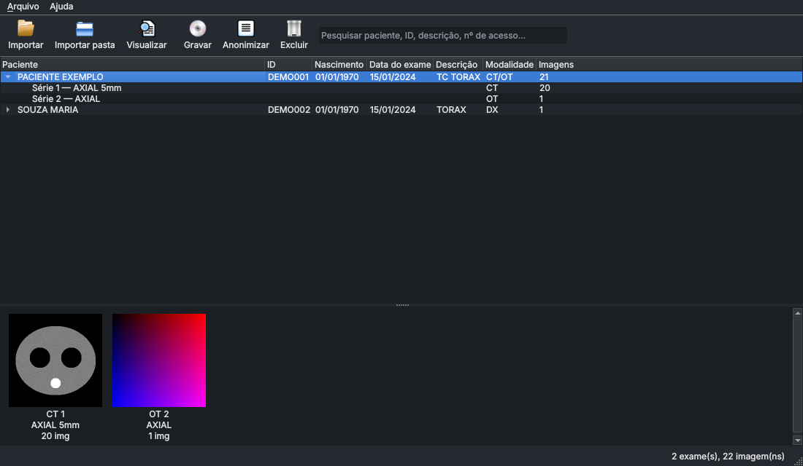
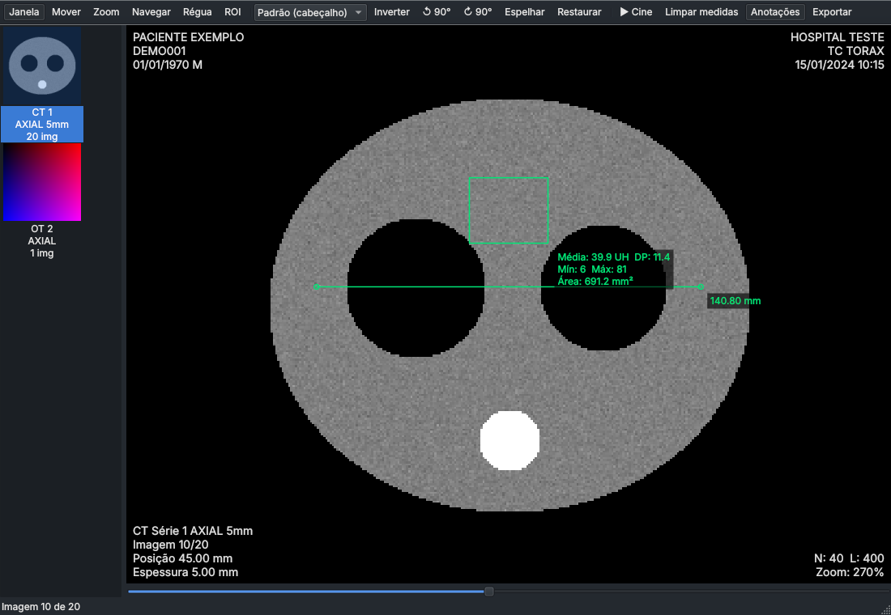
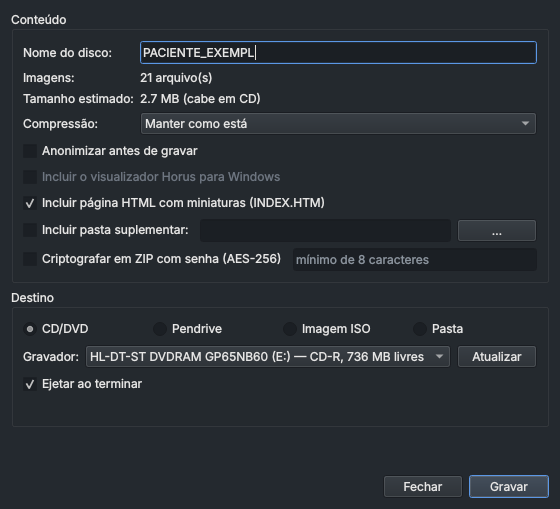

# Horus — visualizador e gravador DICOM para Windows

Reimplementação do fluxo do [Horos](https://horosproject.org) (visualizador
DICOM livre, exclusivo do macOS) com a parte dependente de sistema isolada,
para rodar no Windows: base local de exames, visualizador 2D e gravação de
exames em CD/DVD, pendrive, imagem ISO ou pasta, com DICOMDIR.

Como o Horos funciona, linha a linha, e o que substitui cada dependência
do macOS: [docs/EVIDENCIAS.md](docs/EVIDENCIAS.md).

> Não é um dispositivo médico certificado. Serve para consulta, entrega de
> exames e ensino, não para diagnóstico primário.

| Base de exames | Visualizador | Gravador |
|---|---|---|
|  |  |  |

As telas usam um exame sintético gerado pelos testes. No visualizador, a
ROI sobre o "tecido mole" mede 39,9 UH (valor gerado: 40 UH com ruído de
desvio 12), e a régua mede 140,80 mm (176 pixels de 0,8 mm).

## Funções

**Base de exames** (BrowserController / DicomDatabase)
- importa arquivos, pastas e mídias (lê o DICOMDIR quando houver), por
  menu ou arrastando para a janela;
- copia para `DATABASE.noindex\<lote>\<n>.dcm`, como o Horos, ou só
  referencia (modo disco);
- pesquisa por paciente, ID, descrição, nº de acesso e modalidade;
- miniaturas por série; exclusão; anonimização em cópias novas.

**Visualizador** (ViewerController / DCMView / DCMPix)
- rescale, janela linear, MONOCHROME1, RGB, paleta, multiquadro e objetos
  "enhanced"; codecs JPEG, JPEG-LS (leitura) e JPEG 2000;
- ferramentas: janela, mover, zoom, navegar, régua (mm) e ROI retangular
  (média, DP, mín., máx. e área); predefinições de TC (abdome, cérebro,
  osso, pulmão); inverter, girar, espelhar, cine e exportação em PNG/JPEG;
- anotações nos quatro cantos e valor do pixel sob o cursor (UH em TC).

| Ação | Mouse / teclado |
|---|---|
| ferramenta corrente | botão esquerdo |
| zoom | botão direito, Shift + arrastar, Ctrl + roda |
| mover | botão do meio, Ctrl + arrastar |
| janela | Alt + arrastar (ferramenta "Janela": arrastar para cima/baixo muda o nível, para os lados a largura) |
| imagem anterior/seguinte | roda, ↑ ↓ ← →, PgUp/PgDn (10), Home/End |
| ferramentas | W janela, M mover, Z zoom, N navegar, L régua, O ROI |
| outros | I inverter, `[` `]` girar, H espelhar, R restaurar, Espaço cine, A anotações, Del apaga a última medida, duplo clique ajusta à janela |

**Gravador** (BurnerWindowController)
- nome do disco sugerido pelo paciente (ou `EXAMES_AAAAMMDD` com vários
  pacientes/anonimização), até 15 caracteres — limite do Windows;
- manter, comprimir (JPEG 2000 sem perdas) ou descomprimir, preservando o
  SOPInstanceUID; conversão de big endian;
- DICOMDIR no perfil de mídia geral (como o DCMTK que o Horos usa);
- extras: o próprio Horus para Windows no disco (com `AUTORUN.INF`),
  página `INDEX.HTM` com miniaturas, pasta suplementar e ZIP com senha
  (AES-256);
- destinos:
  - **CD/DVD** pelo IMAPI2 (a API de gravação do Windows). Mostra a mídia e
    o espaço livre e confere a capacidade antes de gravar. Se a política
    da máquina impedir o script, a ISO é aberta no Gravador de Imagem de
    Disco do Windows;
  - **pendrive**: apaga o conteúdo depois de confirmar, copia, renomeia o
    volume e ejeta;
  - **imagem ISO** (ISO 9660 + Joliet; o Windows monta com duplo clique);
  - **pasta**.

## Rodar a partir do código

Requer Python 3.10 ou mais novo (64 bits).

```powershell
cd horus
py -3 -m venv .venv
.venv\Scripts\python -m pip install -e ".[zip]"
.venv\Scripts\python -m horus
```

No Linux ou macOS, o mesmo vale com `python3 -m venv .venv` e
`.venv/bin/python -m horus`.

Opções de linha de comando:

```text
horus [arquivos/pastas/DICOMDIR ...]   importa ao abrir
horus --disc                           lê a mídia de onde o executável roda, sem copiar
horus --data-dir PASTA                 usa outra base local
```

## Gerar o executável do Windows

No Windows, a partir da pasta `horus`:

```powershell
powershell -ExecutionPolicy Bypass -File packaging\build_windows.ps1
```

O script cria o ambiente virtual, roda os testes, gera o ícone, empacota
com PyInstaller em `dist\Horus\Horus.exe` e roda o autoteste do
executável. Com o [Inno Setup 6](https://jrsoftware.org/isinfo.php)
instalado, gera também `dist\Horus-<versão>-setup.exe`. O instalador é por
usuário e não pede administrador.

O workflow `.github/workflows/horus-windows.yml` faz o mesmo num runner
Windows do GitHub Actions e publica o executável e o instalador como
artefato.

## Onde ficam os dados

| | Windows | macOS | Linux |
|---|---|---|---|
| base | `%LOCALAPPDATA%\Horus\Horus Data` | `~/Documents/Horus Data` | `~/.local/share/horus/Horus Data` |
| preparo do disco | `%TEMP%\Horus` | `$TMPDIR/Horus` | `/tmp/Horus` |

`HORUS_DATA_DIR` ou `--data-dir` mudam o local da base. No Windows a base
fica em `LOCALAPPDATA`, e não em Documentos, porque Documentos costuma
estar no OneDrive, que enviaria os exames para a nuvem.

## Testes

```bash
cd horus
python -m pip install -e ".[zip,dev]"
QT_QPA_PLATFORM=offscreen python -m pytest -q
```

Os testes geram exames sintéticos; nenhum dado de paciente entra no
repositório. `tests/test_windows_real.py` só roda no Windows, porque chama
o IMAPI2 e a API Win32 de verdade.

## Estrutura

```text
horus/
  src/horus/
    dicom/        pixels (DCMPix), série, predefinições, miniaturas, gravação de arquivos
    database.py   base local (DicomDatabase)
    importer.py   detecção de DICOM e leitura de DICOMDIR
    anonymize.py  anonimização (Anonymization)
    burn/         preparo do disco, DICOMDIR, ISO e destinos (BurnerWindowController)
    platform/     Windows (IMAPI2, Win32), macOS (drutil/diskutil) e Linux
    gui/          interface Qt: navegador, visualizador, gravador
    selftest.py   autoteste do executável empacotado
  packaging/      PyInstaller, ícone, build do Windows e instalador
  tests/
  docs/EVIDENCIAS.md
```

## Limitações

- só 2D: sem MPR, 3D, renderização de volume ou fusão PET/CT;
- sem rede DICOM (recepção C-STORE, envio, Query/Retrieve);
- ROIs só de régua e retângulo;
- durante a escrita em CD/DVD o progresso é indeterminado, porque o
  IMAPI2 não entrega eventos ao PowerShell durante `Write`;
- texto gravado dentro da imagem (ultrassom, capturas de tela) não é
  removido pela anonimização;
- a gravação física em CD/DVD e pendrive ainda precisa ser homologada num
  Windows com gravador. O protocolo do script e a parte Win32 têm testes,
  mas aqui eles rodaram com o processo simulado.
