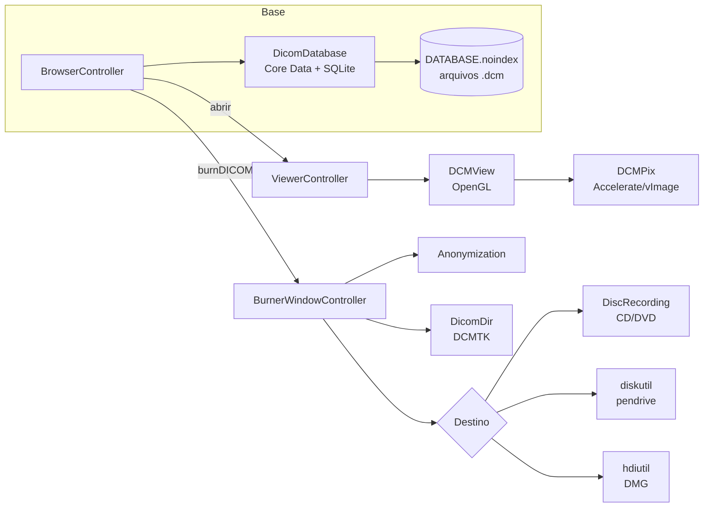

# Como o Horos funciona — evidências

Este documento registra o que foi verificado no código-fonte do Horos para
construir o Horus. Cada afirmação aponta para o arquivo e a linha de onde
saiu.

**Fonte analisada:** repositório oficial
[horosproject/horos](https://github.com/horosproject/horos), commit
[`2a13050`](https://github.com/horosproject/horos/tree/2a130506f2ae651fcd52becbd5469c107bbbf795)
(merge de 8 fev. 2026, linha 4.0.x). Licença LGPL-3.0.

**Sobre o nome:** o pedido fala em "Horus". O visualizador DICOM livre para
macOS com esse perfil (visualizar e gravar exames em mídia) é o **Horos**,
derivado do OsiriX; a busca não encontrou um visualizador para macOS
chamado Horus. A análise parte dessa premissa: o código estudado é o do
Horos, e o aplicativo novo se chama Horus.

Os links apontam para esse commit, e os números de linha valem para ele.

---

## 1. Arquitetura geral

O Horos é um aplicativo Cocoa em Objective-C/Objective-C++, compilado
pelo Xcode (`Horos.xcodeproj`). A pasta `Horos/Sources` tem 697
arquivos. As bibliotecas de imagem médica vêm embutidas como subprojetos
na raiz: DCMTK, GDCM, OpenJPEG, CharLS, Grok, Papyrus3, ITK, VTK, OpenSSL e
o "DCM Framework".

Frameworks da Apple vinculados, contados no `Horos.xcodeproj/project.pbxproj`:
Cocoa/AppKit, **Accelerate**, **OpenGL** e AGL, CoreVideo, QuartzCore,
**DiscRecording** e **DiscRecordingUI**, **DiskArbitration**, IOKit,
WebKit, AVFoundation, Security, PreferencePanes e Carbon. Os que estão em
negrito sustentam o visualizador e o gravador e não existem fora do macOS.

| Módulo | Papel | Tamanho |
|---|---|---|
| `BrowserController.m` | janela principal da base de exames | 20 737 linhas |
| `DicomDatabase.mm` | base local (Core Data sobre SQLite) | 4 270 |
| `DCMPix.m` | leitura dos pixels, rescale, janela | 10 962 |
| `DCMView.m` | desenho da imagem (OpenGL) e ferramentas | 13 918 |
| `ViewerController.m` | janela do visualizador 2D | 22 872 |
| `BurnerWindowController.m` | gravador de CD/DVD/USB/DMG | 1 285 |
| `DicomDir.mm` | geração do DICOMDIR | 95 |
| `Anonymization.mm` | anonimização | 715 |

## 2. Base local de exames

| Evidência | O que mostra |
|---|---|
| [`DicomDatabase.mm:114`](https://github.com/horosproject/horos/blob/2a130506f2ae651fcd52becbd5469c107bbbf795/Horos/Sources/DicomDatabase.mm#L114) | o índice é o arquivo `Database.sql` |
| [`DicomDatabase.mm:115`](https://github.com/horosproject/horos/blob/2a130506f2ae651fcd52becbd5469c107bbbf795/Horos/Sources/DicomDatabase.mm#L115) | a pasta-base se chama `Horos Data` |
| [`DicomDatabase.mm:764`](https://github.com/horosproject/horos/blob/2a130506f2ae651fcd52becbd5469c107bbbf795/Horos/Sources/DicomDatabase.mm#L764), [`:768`](https://github.com/horosproject/horos/blob/2a130506f2ae651fcd52becbd5469c107bbbf795/Horos/Sources/DicomDatabase.mm#L768) | arquivos em `DATABASE.noindex`, recepção em `INCOMING.noindex` (o sufixo `.noindex` impede a indexação pelo Spotlight) |
| [`DicomDatabase.mm:729`](https://github.com/horosproject/horos/blob/2a130506f2ae651fcd52becbd5469c107bbbf795/Horos/Sources/DicomDatabase.mm#L729)–731 | entidades `Image`, `Series`, `Study` |
| [`DicomDatabase.mm:3562`](https://github.com/horosproject/horos/blob/2a130506f2ae651fcd52becbd5469c107bbbf795/Horos/Sources/DicomDatabase.mm#L3562) | persistência Core Data com `NSSQLiteStoreType` |
| [`DicomDatabase.mm:925`](https://github.com/horosproject/horos/blob/2a130506f2ae651fcd52becbd5469c107bbbf795/Horos/Sources/DicomDatabase.mm#L925), [`:953`](https://github.com/horosproject/horos/blob/2a130506f2ae651fcd52becbd5469c107bbbf795/Horos/Sources/DicomDatabase.mm#L953) | cada arquivo recebido vira `<lote>/<n>.dcm`, com lote = `tamanho × (n / tamanho + 1)` |
| [`BrowserController.m:537`](https://github.com/horosproject/horos/blob/2a130506f2ae651fcd52becbd5469c107bbbf795/Horos/Sources/BrowserController.m#L537) | o tamanho do lote é 10 000 |
| [`DicomDatabase.mm:1475`](https://github.com/horosproject/horos/blob/2a130506f2ae651fcd52becbd5469c107bbbf795/Horos/Sources/DicomDatabase.mm#L1475) | `addFilesAtPaths:` é o ponto de importação |
| [`DicomFile.mm:721`](https://github.com/horosproject/horos/blob/2a130506f2ae651fcd52becbd5469c107bbbf795/Horos/Sources/DicomFile.mm#L721)–733 | arquivo é DICOM se o `gdcm::Scanner` encontrar o SeriesInstanceUID, com ou sem preâmbulo |
| `DicomStudy.h`, `DicomSeries.h`, `DicomImage.h` | atributos por nível: paciente e exame no Study; modalidade, descrição e miniatura no Series; caminho, número de instância e quadros no Image |

## 3. Visualizador

### 3.1 Pixels (DCMPix)

| Evidência | O que mostra |
|---|---|
| [`DCMPix.m:88`](https://github.com/horosproject/horos/blob/2a130506f2ae651fcd52becbd5469c107bbbf795/Horos/Sources/DCMPix.m#L88) | usa o framework Accelerate (vImage/vDSP) |
| [`DCMPix.m:5582`](https://github.com/horosproject/horos/blob/2a130506f2ae651fcd52becbd5469c107bbbf795/Horos/Sources/DCMPix.m#L5582)–5586 | lê RescaleIntercept/RescaleSlope e troca slope 0 por 1 |
| [`DCMPix.m:6787`](https://github.com/horosproject/horos/blob/2a130506f2ae651fcd52becbd5469c107bbbf795/Horos/Sources/DCMPix.m#L6787) | converte os pixels para float aplicando o rescale: `vImageConvert_16SToF(..., offset, slope, 0)` |
| [`DCMPix.m:6069`](https://github.com/horosproject/horos/blob/2a130506f2ae651fcd52becbd5469c107bbbf795/Horos/Sources/DCMPix.m#L6069), [`:6104`](https://github.com/horosproject/horos/blob/2a130506f2ae651fcd52becbd5469c107bbbf795/Horos/Sources/DCMPix.m#L6104) | em objetos multiquadro "enhanced", busca espaçamento e rescale nas sequências funcionais |
| [`DCMPix.m:5660`](https://github.com/horosproject/horos/blob/2a130506f2ae651fcd52becbd5469c107bbbf795/Horos/Sources/DCMPix.m#L5660)–5661 | PixelSpacing[0] = Y (linhas), [1] = X (colunas); usa ImagerPixelSpacing quando falta |
| [`DCMPix.m:6541`](https://github.com/horosproject/horos/blob/2a130506f2ae651fcd52becbd5469c107bbbf795/Horos/Sources/DCMPix.m#L6541)–6549 | MONOCHROME1: os valores são multiplicados por −1 (`inverseVal`) |
| [`DCMPix.m:9877`](https://github.com/horosproject/horos/blob/2a130506f2ae651fcd52becbd5469c107bbbf795/Horos/Sources/DCMPix.m#L9877), [`:9902`](https://github.com/horosproject/horos/blob/2a130506f2ae651fcd52becbd5469c107bbbf795/Horos/Sources/DCMPix.m#L9902)–9903, [`:9953`](https://github.com/horosproject/horos/blob/2a130506f2ae651fcd52becbd5469c107bbbf795/Horos/Sources/DCMPix.m#L9953) | a imagem de 8 bits sai da janela linear: `min = wl − ww/2`, `max = wl + ww/2`, via `vImageConvert_PlanarFtoPlanar8` |
| [`DCMPix.m:10076`](https://github.com/horosproject/horos/blob/2a130506f2ae651fcd52becbd5469c107bbbf795/Horos/Sources/DCMPix.m#L10076) | em RGB, a mesma janela é aplicada por tabela de 256 entradas |
| [`DCMPix.m:10085`](https://github.com/horosproject/horos/blob/2a130506f2ae651fcd52becbd5469c107bbbf795/Horos/Sources/DCMPix.m#L10085), [`:10115`](https://github.com/horosproject/horos/blob/2a130506f2ae651fcd52becbd5469c107bbbf795/Horos/Sources/DCMPix.m#L10115) | `changeWLWW`: largura mínima de `0,001 × slope`; sem valores, usa a faixa completa |

**Defeito encontrado.** Em
[`DCMPix.m:6549`](https://github.com/horosproject/horos/blob/2a130506f2ae651fcd52becbd5469c107bbbf795/Horos/Sources/DCMPix.m#L6549)
a linha é `else inverseVal = YES; savedWL = -savedWL;`, sem chaves. Pela
indentação, as duas instruções pertencem ao `else`. Pela semântica do C,
só a primeira pertence, e `savedWL` também é negado nos PET/NM
MONOCHROME1, que deveriam ficar intactos. O Horus não reproduz o defeito:
os valores ficam como estão e a inversão acontece só na saída de 8 bits.

### 3.2 Desenho e interação (DCMView, ViewerController)

| Evidência | O que mostra |
|---|---|
| [`DCMView.m:64`](https://github.com/horosproject/horos/blob/2a130506f2ae651fcd52becbd5469c107bbbf795/Horos/Sources/DCMView.m#L64)–67, [`:3714`](https://github.com/horosproject/horos/blob/2a130506f2ae651fcd52becbd5469c107bbbf795/Horos/Sources/DCMView.m#L3714) | desenho em OpenGL legado (CGL, `GL_TEXTURE_RECTANGLE_EXT`) |
| [`DCMView.h:62`](https://github.com/horosproject/horos/blob/2a130506f2ae651fcd52becbd5469c107bbbf795/Horos/Sources/DCMView.h#L62)–93 | ferramentas: `tWL`, `tTranslate`, `tZoom`, `tRotate`, `tNext`, `tMesure`, `tROI`... |
| [`DCMView.m:4001`](https://github.com/horosproject/horos/blob/2a130506f2ae651fcd52becbd5469c107bbbf795/Horos/Sources/DCMView.m#L4001)–4030 | `getTool:`: botão direito usa a ferramenta da direita, o do meio move; ⌘ move, ⌥ ajusta a janela, ⇧ dá zoom |
| [`DCMView.m:5686`](https://github.com/horosproject/horos/blob/2a130506f2ae651fcd52becbd5469c107bbbf795/Horos/Sources/DCMView.m#L5686)–5692 | arrastar ajusta a janela com passo `startWW / 80` por pixel: vertical muda o nível, horizontal a largura |
| [`DCMView.m:4847`](https://github.com/horosproject/horos/blob/2a130506f2ae651fcd52becbd5469c107bbbf795/Horos/Sources/DCMView.m#L4847) | roda do mouse troca de imagem |
| [`ViewerController.m:2928`](https://github.com/horosproject/horos/blob/2a130506f2ae651fcd52becbd5469c107bbbf795/Horos/Sources/ViewerController.m#L2928) | ao abrir, a série inteira é lida numa thread ("Start async reading of all images") |
| [`DefaultsOsiriX.m:317`](https://github.com/horosproject/horos/blob/2a130506f2ae651fcd52becbd5469c107bbbf795/Horos/Sources/DefaultsOsiriX.m#L317)–332 | predefinições `WLWW3`: Pulmonar −500/1400, Osso 300/1500, Cérebro 50/100, Abdome 40/350 |

## 4. Gravador

### 4.1 Fluxo

1. **Entrada:** `burnDICOM:`
   ([`BrowserController.m:17956`](https://github.com/horosproject/horos/blob/2a130506f2ae651fcd52becbd5469c107bbbf795/Horos/Sources/BrowserController.m#L17956))
   junta os arquivos da seleção e abre o `BurnerWindowController`. Só pode
   haver uma sessão de gravação aberta por vez.
2. **Vários pacientes:**
   [`:126`](https://github.com/horosproject/horos/blob/2a130506f2ae651fcd52becbd5469c107bbbf795/Horos/Sources/BurnerWindowController.m#L126)–136
   compara o `patientUID` de todos os objetos.
3. **Nome do disco:** com um paciente, o nome dele em maiúsculas
   (`defaultTitle`,
   [`:755`](https://github.com/horosproject/horos/blob/2a130506f2ae651fcd52becbd5469c107bbbf795/Horos/Sources/BurnerWindowController.m#L755)).
   Com vários pacientes ou anonimização, `Archive-AAAAMMDD`
   ([`:799`](https://github.com/horosproject/horos/blob/2a130506f2ae651fcd52becbd5469c107bbbf795/Horos/Sources/BurnerWindowController.m#L799)).
4. **Validações em `burn:`**
   ([`:248`](https://github.com/horosproject/horos/blob/2a130506f2ae651fcd52becbd5469c107bbbf795/Horos/Sources/BurnerWindowController.m#L248)):
   painel de anonimização; no pendrive, a confirmação "The ENTIRE content
   of the selected media will be deleted"
   ([`:317`](https://github.com/horosproject/horos/blob/2a130506f2ae651fcd52becbd5469c107bbbf795/Horos/Sources/BurnerWindowController.m#L317));
   senha de no mínimo 8 caracteres para o ZIP
   ([`:372`](https://github.com/horosproject/horos/blob/2a130506f2ae651fcd52becbd5469c107bbbf795/Horos/Sources/BurnerWindowController.m#L372)).
5. **`performBurn`**
   ([`:408`](https://github.com/horosproject/horos/blob/2a130506f2ae651fcd52becbd5469c107bbbf795/Horos/Sources/BurnerWindowController.m#L408)):
   anonimiza em `/tmp/burnAnonymized`
   ([`:423`](https://github.com/horosproject/horos/blob/2a130506f2ae651fcd52becbd5469c107bbbf795/Horos/Sources/BurnerWindowController.m#L423)),
   monta a pasta em `/tmp/<nome do CD>` (`folderToBurn`,
   [`:514`](https://github.com/horosproject/horos/blob/2a130506f2ae651fcd52becbd5469c107bbbf795/Horos/Sources/BurnerWindowController.m#L514))
   e escolhe o destino pelo `burnDestination`
   ([`:444`](https://github.com/horosproject/horos/blob/2a130506f2ae651fcd52becbd5469c107bbbf795/Horos/Sources/BurnerWindowController.m#L444)):
   `CDDVD`, `USBKey` ou `DMGFile` (enum em `BurnerWindowController.h`).

### 4.2 Conteúdo do disco (`prepareCDContent`, [`:920`](https://github.com/horosproject/horos/blob/2a130506f2ae651fcd52becbd5469c107bbbf795/Horos/Sources/BurnerWindowController.m#L920))

| Etapa | Linha | Detalhe |
|---|---|---|
| cópia | [967](https://github.com/horosproject/horos/blob/2a130506f2ae651fcd52becbd5469c107bbbf795/Horos/Sources/BurnerWindowController.m#L967) | `DICOM/00000`, `DICOM/00001`... (nomes de 5 dígitos, válidos em ISO 9660) |
| big endian | [973](https://github.com/horosproject/horos/blob/2a130506f2ae651fcd52becbd5469c107bbbf795/Horos/Sources/BurnerWindowController.m#L973), [996](https://github.com/horosproject/horos/blob/2a130506f2ae651fcd52becbd5469c107bbbf795/Horos/Sources/BurnerWindowController.m#L996) | Explicit VR Big Endian é convertido antes de gravar |
| compressão | [1023](https://github.com/horosproject/horos/blob/2a130506f2ae651fcd52becbd5469c107bbbf795/Horos/Sources/BurnerWindowController.m#L1023), [1027](https://github.com/horosproject/horos/blob/2a130506f2ae651fcd52becbd5469c107bbbf795/Horos/Sources/BurnerWindowController.m#L1027) | modo 0 mantém, 1 comprime, 2 descomprime |
| DICOMDIR | [1043](https://github.com/horosproject/horos/blob/2a130506f2ae651fcd52becbd5469c107bbbf795/Horos/Sources/BurnerWindowController.m#L1043) | `DicomDir createDicomDirAtDir:` |
| visualizador | [1078](https://github.com/horosproject/horos/blob/2a130506f2ae651fcd52becbd5469c107bbbf795/Horos/Sources/BurnerWindowController.m#L1078) | copia o Weasis e troca `Label=Weasis` pelo nome do disco no `Autorun.inf` |
| HTML | [1112](https://github.com/horosproject/horos/blob/2a130506f2ae651fcd52becbd5469c107bbbf795/Horos/Sources/BurnerWindowController.m#L1112) | páginas com as imagens (só sem anonimização) |
| pasta suplementar | [1125](https://github.com/horosproject/horos/blob/2a130506f2ae651fcd52becbd5469c107bbbf795/Horos/Sources/BurnerWindowController.m#L1125) | conteúdo copiado na raiz |
| laudos | [1145](https://github.com/horosproject/horos/blob/2a130506f2ae651fcd52becbd5469c107bbbf795/Horos/Sources/BurnerWindowController.m#L1145) | laudos dos exames, convertidos para PDF quando possível |
| ZIP com senha | [1194](https://github.com/horosproject/horos/blob/2a130506f2ae651fcd52becbd5469c107bbbf795/Horos/Sources/BurnerWindowController.m#L1194) | `encryptedDICOM.zip` + `ReadMe.txt` |

### 4.3 DICOMDIR ([`DicomDir.mm`](https://github.com/horosproject/horos/blob/2a130506f2ae651fcd52becbd5469c107bbbf795/Horos/Sources/DicomDir.mm#L48))

Usa o `DicomDirInterface` do DCMTK com `disableConsistencyCheck` (`-W`),
`disableTransferSyntaxCheck` (`-Nxc`), `enableInventMode` (`+I`, inventa
os atributos obrigatórios que faltam), ícone por série, perfil
`AP_USBandFlash` (`-Pfl`), varredura recursiva da pasta e gravação com
comprimentos explícitos (linhas 54–81).

### 4.4 Destinos

| Destino | Linha | Mecanismo |
|---|---|---|
| CD/DVD | [594](https://github.com/horosproject/horos/blob/2a130506f2ae651fcd52becbd5469c107bbbf795/Horos/Sources/BurnerWindowController.m#L594)–626 | DiscRecording: `DRTrack trackForRootFolder:` + `DRBurnSetupPanel` + `DRBurnProgressPanel` |
| checagem de mídia | [637](https://github.com/horosproject/horos/blob/2a130506f2ae651fcd52becbd5469c107bbbf795/Horos/Sources/BurnerWindowController.m#L637)–656 | blocos livres × tamanho: "you need a DVD" |
| bloqueio | [629](https://github.com/horosproject/horos/blob/2a130506f2ae651fcd52becbd5469c107bbbf795/Horos/Sources/BurnerWindowController.m#L629) | não deixa sair do aplicativo durante a gravação |
| pendrive: lista | [519](https://github.com/horosproject/horos/blob/2a130506f2ae651fcd52becbd5469c107bbbf795/Horos/Sources/BurnerWindowController.m#L519)–531 | `NSWorkspace mountedRemovableMedia`: removível, gravável e desmontável |
| pendrive: gravação | [538](https://github.com/horosproject/horos/blob/2a130506f2ae651fcd52becbd5469c107bbbf795/Horos/Sources/BurnerWindowController.m#L538)–591 | apaga tudo, copia, `diskutil rename` (nome → 10 caracteres → `DICOM`) e ejeta |
| DMG | [70](https://github.com/horosproject/horos/blob/2a130506f2ae651fcd52becbd5469c107bbbf795/Horos/Sources/BurnerWindowController.m#L70)–93 | `hdiutil create <arquivo>.dmg -srcfolder <pasta>` |
| tamanho | [878](https://github.com/horosproject/horos/blob/2a130506f2ae651fcd52becbd5469c107bbbf795/Horos/Sources/BurnerWindowController.m#L878) | `/usr/bin/du -ks` |

## 5. Portabilidade para o Windows

Ponto a ponto, o que é exclusivo do macOS e o que o substitui:

| Função | Horos (macOS) | Horus (Windows) | Onde |
|---|---|---|---|
| Interface | AppKit + .xib | Qt 6 (PySide6) | `gui/` |
| Desenho da imagem | OpenGL legado (CGL) | QPainter (sem depender de OpenGL; funciona em VM e área de trabalho remota) | `gui/imageview.py` |
| Conversões de pixel | Accelerate (vImage/vDSP) | NumPy | `dicom/pixels.py` |
| Leitura DICOM e codecs | DCMTK, GDCM, OpenJPEG, CharLS embutidos | pydicom + pylibjpeg (rodas binárias para Windows) | `dicom/` |
| Base local | Core Data | SQLite direto, mesmo esquema Study → Series → Image | `database.py` |
| Pasta da base | `~/Documents/Horos Data` | `%LOCALAPPDATA%\Horus\Horus Data` (fora do OneDrive, que sincroniza Documentos) | `paths.py` |
| Fora do índice de busca | sufixo `.noindex` (Spotlight) | atributo `FILE_ATTRIBUTE_NOT_CONTENT_INDEXED` | `paths.py` |
| Pasta temporária | `/tmp` | `%TEMP%` | `paths.py` |
| DICOMDIR | DCMTK `DicomDirInterface` | gerador próprio, mesmo resultado (conferido com o `dcmmkdir` do DCMTK) | `burn/dicomdir.py` |
| Gravação de CD/DVD | DiscRecording / DiscRecordingUI | **IMAPI2** (`MsftDiscFormat2Data` + `IMAPI2FS`) pelo PowerShell 5.1 nativo | `platform/imapi2.ps1`, `platform/windows.py` |
| Escolha de gravador e mídia | `DRBurnSetupPanel` | lista no diálogo, com tipo de mídia e espaço livre lidos do IMAPI2 | `gui/burner.py` |
| Checagem de capacidade | `deviceContainsSuitableMedia:` | `FreeSectorsOnMedia` × `TotalBlocks`, e checagem prévia | `burn/destinations.py` |
| Imagem de disco | DMG (`hdiutil`), não abre no Windows | **ISO 9660 nível 1 + Joliet** (pycdlib), montável e gravável pelo próprio Windows | `burn/iso.py` |
| Plano B sem IMAPI2 | — | ISO entregue ao `isoburn.exe` (Gravador de Imagem de Disco do Windows) | `burn/destinations.py` |
| Lista de pendrives | `NSWorkspace mountedRemovableMedia` | `GetLogicalDrives` + `GetDriveTypeW` (sem caixas "não há disco" para leitores vazios) | `platform/windows.py` |
| Rótulo do pendrive | `diskutil rename` | `SetVolumeLabelW` (FAT: 11 caracteres), mesma sequência de tentativas | `platform/windows.py`, `burn/destinations.py` |
| Ejeção | `unmountAndEjectDeviceAtPath:` | `FSCTL_LOCK_VOLUME` → `FSCTL_DISMOUNT_VOLUME` → `IOCTL_STORAGE_EJECT_MEDIA` | `platform/windows.py` |
| Tamanho de pasta | `/usr/bin/du` | soma em Python, arredondada a setores de 2048 bytes | `burn/iso.py` |
| Visualizador no disco | Weasis/Horos Lite + `Autorun.inf` | o próprio Horus.exe em `HORUS\` + `AUTORUN.INF`; com `--disc`, lê o DICOMDIR da mídia sem copiar | `burn/prepare.py`, `gui/app.py` |
| ZIP com senha | `zip -e` (ZipCrypto, fraco) | ZIP AES-256 (pyzipper) | `burn/prepare.py` |
| Atalho ⌘ | `NSCommandKeyMask` | Ctrl (no Qt, `ControlModifier` já é ⌘ no Mac e Ctrl no Windows) | `gui/imageview.py` |
| Eixo Y do mouse | Cocoa: cresce para cima | Qt: cresce para baixo; sinal invertido no arraste de janela | `gui/imageview.py` |

### Limites impostos pelo Windows

* **Rótulo do volume:** o IMAPI2 aceita no máximo 15 caracteres, só A–Z,
  0–9 e `_` em ISO 9660 (`IMAPI_E_INVALID_VOLUME_NAME`). O nome sugerido
  `Archive-AAAAMMDD` do Horos tem 16, então virou `EXAMES_AAAAMMDD`.
* **PowerShell 5.1 e codificação:** scripts sem BOM são lidos na página de
  código ANSI. O `imapi2.ps1` é gravado com BOM e usa só ASCII nas strings
  (as mensagens em português são montadas no Python).
* **Política de execução:** o script roda com `-ExecutionPolicy Bypass`.
  Se uma política de grupo bloquear mesmo assim, a gravação cai para a ISO
  + `isoburn.exe`.
* **COM do IMAPI2** exige apartamento single-threaded: o PowerShell roda
  com `-STA`.
* **Progresso da gravação:** `MsftDiscFormat2Data.Write` é síncrono, e os
  eventos COM não chegam ao PowerShell durante a chamada. A interface
  mostra as fases (montagem do sistema de arquivos, gravação, conclusão) e
  uma barra indeterminada durante a escrita. O Horos mostrava a
  porcentagem pelo painel do DiscRecordingUI.

## 6. O que não foi portado

O Horos é uma estação de trabalho completa. O pedido era o visualizador e
o gravador, e ficaram de fora:

* reconstruções MPR, CPR, 3D, renderização de volume e endoscopia (VTK/ITK);
* rede DICOM: listener C-STORE, envio, Query/Retrieve (`DCMTKQueryRetrieveSCP`)
  — o caminho natural é o `pynetdicom`;
* fusão PET/CT e SUV, subtração, filtros de convolução;
* ROIs além de régua e retângulo (polígonos, lápis, ângulo, 3D);
* plugins, portal web, laudos, impressão DICOM, protocolos de exibição;
* ícones no DICOMDIR (o Horos grava um por série) e laudos no disco.

## 7. Como a implementação foi verificada

* **Testes automatizados** (`pytest`): rescale, janela, MONOCHROME1, RGB,
  multiquadro, grupos funcionais, medidas, base, importação por DICOMDIR,
  anonimização, compressão sem perdas (pixels idênticos e SOPInstanceUID
  preservado), conversão de big endian, ISO relida, pendrive simulado,
  plano B da gravação, protocolo do script Windows e as três janelas em
  modo offscreen.
* **DICOMDIR conferido com o DCMTK:** o `dcmmkdir` (a ferramenta de linha
  de comando do mesmo DicomDirInterface que o Horos usa) leu o DICOMDIR do
  Horus e reconheceu as instâncias. Gerados para a mesma pasta, os dois
  DICOMDIR têm a mesma árvore (PATIENT → STUDY → SERIES → IMAGE) e os
  mesmos atributos obrigatórios; o Horus inclui alguns opcionais a mais
  (descrição da série, médico solicitante).
* **ISO conferida com `isoinfo`:** nomes ISO 9660 nível 1 (`DICOMDIR.;1`,
  `DICOM/00000.;1`) e Joliet com os nomes originais.
* **Script IMAPI2:** sem erros no parser oficial do PowerShell, e executado
  de ponta a ponta pelo `WindowsPlatform`. O caminho de erro e o JSON
  foram validados; o COM do IMAPI2 só existe no Windows.
* **Executável:** gerado com PyInstaller e submetido a `--self-test`, que
  codifica e decodifica JPEG 2000, monta DICOMDIR e ISO e carrega a camada
  de plataforma dentro do binário congelado.
* **Windows de verdade:** o workflow `.github/workflows/horus-windows.yml`
  roda os testes num runner Windows, incluindo os que chamam o IMAPI2 e a
  Win32 de verdade (`tests/test_windows_real.py`). Ele também gera o
  `Horus.exe`, o autotesta e produz o instalador. A gravação física em
  CD/DVD e pendrive precisa ser homologada numa máquina com gravador.
