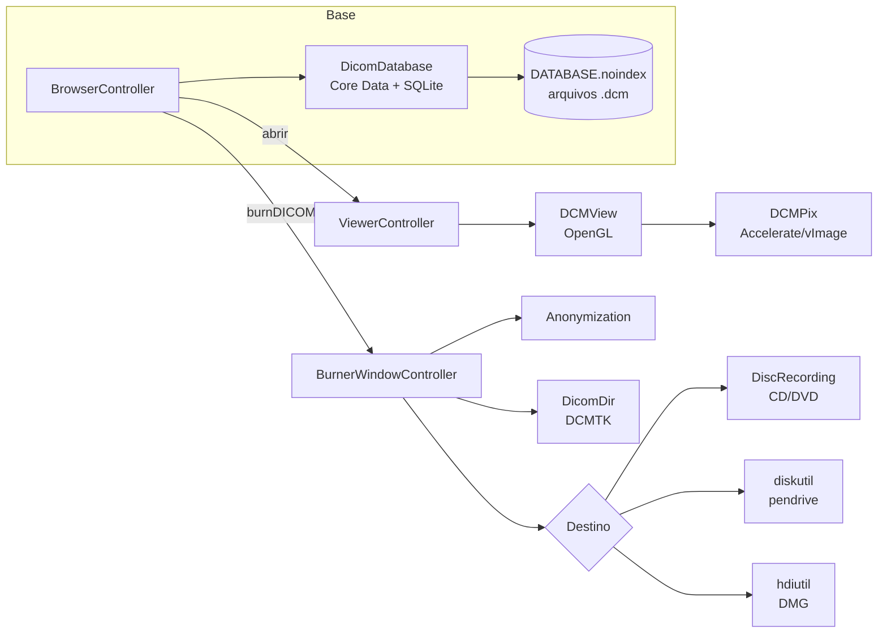
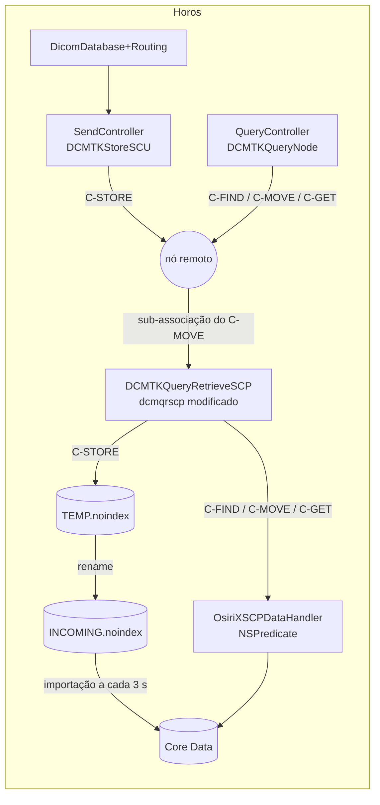

# Como o Horos funciona — evidências

Este documento registra o que foi verificado no código-fonte do Horos para
construir o Horus. Cada afirmação aponta para o arquivo e a linha de onde
saiu.

**Fonte analisada:** repositório oficial
[horosproject/horos](https://github.com/horosproject/horos), commit
[`2a13050`](https://github.com/horosproject/horos/tree/2a130506f2ae651fcd52becbd5469c107bbbf795)
(merge de 8 fev. 2026, linha 4.0.x). Licença LGPL-3.0.

**Sobre o nome:** o pedido fala em "Horus". O visualizador DICOM livre para
macOS com esse perfil (visualizar e gravar exames em mídia) é o **Horos**,
derivado do OsiriX; a busca não encontrou um visualizador para macOS
chamado Horus. A análise parte dessa premissa: o código estudado é o do
Horos, e o aplicativo novo se chama Horus.

Os links apontam para esse commit, e os números de linha valem para ele.

---

## 1. Arquitetura geral

O Horos é um aplicativo Cocoa em Objective-C/Objective-C++, compilado
pelo Xcode (`Horos.xcodeproj`). A pasta `Horos/Sources` tem 697
arquivos. As bibliotecas de imagem médica vêm embutidas como subprojetos
na raiz: DCMTK, GDCM, OpenJPEG, CharLS, Grok, Papyrus3, ITK, VTK, OpenSSL e
o "DCM Framework".

Frameworks da Apple vinculados, contados no `Horos.xcodeproj/project.pbxproj`:
Cocoa/AppKit, **Accelerate**, **OpenGL** e AGL, CoreVideo, QuartzCore,
**DiscRecording** e **DiscRecordingUI**, **DiskArbitration**, IOKit,
WebKit, AVFoundation, Security, PreferencePanes e Carbon. Os que estão em
negrito sustentam o visualizador e o gravador e não existem fora do macOS.

| Módulo | Papel | Tamanho |
|---|---|---|
| `BrowserController.m` | janela principal da base de exames | 20 737 linhas |
| `DicomDatabase.mm` | base local (Core Data sobre SQLite) | 4 270 |
| `DCMPix.m` | leitura dos pixels, rescale, janela | 10 962 |
| `DCMView.m` | desenho da imagem (OpenGL) e ferramentas | 13 918 |
| `ViewerController.m` | janela do visualizador 2D | 22 872 |
| `BurnerWindowController.m` | gravador de CD/DVD/USB/DMG | 1 285 |
| `DicomDir.mm` | geração do DICOMDIR | 95 |
| `Anonymization.mm` | anonimização | 715 |

## 2. Base local de exames

| Evidência | O que mostra |
|---|---|
| [`DicomDatabase.mm:114`](https://github.com/horosproject/horos/blob/2a130506f2ae651fcd52becbd5469c107bbbf795/Horos/Sources/DicomDatabase.mm#L114) | o índice é o arquivo `Database.sql` |
| [`DicomDatabase.mm:115`](https://github.com/horosproject/horos/blob/2a130506f2ae651fcd52becbd5469c107bbbf795/Horos/Sources/DicomDatabase.mm#L115) | a pasta-base se chama `Horos Data` |
| [`DicomDatabase.mm:764`](https://github.com/horosproject/horos/blob/2a130506f2ae651fcd52becbd5469c107bbbf795/Horos/Sources/DicomDatabase.mm#L764), [`:768`](https://github.com/horosproject/horos/blob/2a130506f2ae651fcd52becbd5469c107bbbf795/Horos/Sources/DicomDatabase.mm#L768) | arquivos em `DATABASE.noindex`, recepção em `INCOMING.noindex` (o sufixo `.noindex` impede a indexação pelo Spotlight) |
| [`DicomDatabase.mm:729`](https://github.com/horosproject/horos/blob/2a130506f2ae651fcd52becbd5469c107bbbf795/Horos/Sources/DicomDatabase.mm#L729)–731 | entidades `Image`, `Series`, `Study` |
| [`DicomDatabase.mm:3562`](https://github.com/horosproject/horos/blob/2a130506f2ae651fcd52becbd5469c107bbbf795/Horos/Sources/DicomDatabase.mm#L3562) | persistência Core Data com `NSSQLiteStoreType` |
| [`DicomDatabase.mm:925`](https://github.com/horosproject/horos/blob/2a130506f2ae651fcd52becbd5469c107bbbf795/Horos/Sources/DicomDatabase.mm#L925), [`:953`](https://github.com/horosproject/horos/blob/2a130506f2ae651fcd52becbd5469c107bbbf795/Horos/Sources/DicomDatabase.mm#L953) | cada arquivo recebido vira `<lote>/<n>.dcm`, com lote = `tamanho × (n / tamanho + 1)` |
| [`BrowserController.m:537`](https://github.com/horosproject/horos/blob/2a130506f2ae651fcd52becbd5469c107bbbf795/Horos/Sources/BrowserController.m#L537) | o tamanho do lote é 10 000 |
| [`DicomDatabase.mm:1475`](https://github.com/horosproject/horos/blob/2a130506f2ae651fcd52becbd5469c107bbbf795/Horos/Sources/DicomDatabase.mm#L1475) | `addFilesAtPaths:` é o ponto de importação |
| [`DicomFile.mm:721`](https://github.com/horosproject/horos/blob/2a130506f2ae651fcd52becbd5469c107bbbf795/Horos/Sources/DicomFile.mm#L721)–733 | arquivo é DICOM se o `gdcm::Scanner` encontrar o SeriesInstanceUID, com ou sem preâmbulo |
| `DicomStudy.h`, `DicomSeries.h`, `DicomImage.h` | atributos por nível: paciente e exame no Study; modalidade, descrição e miniatura no Series; caminho, número de instância e quadros no Image |

## 3. Visualizador

### 3.1 Pixels (DCMPix)

| Evidência | O que mostra |
|---|---|
| [`DCMPix.m:88`](https://github.com/horosproject/horos/blob/2a130506f2ae651fcd52becbd5469c107bbbf795/Horos/Sources/DCMPix.m#L88) | usa o framework Accelerate (vImage/vDSP) |
| [`DCMPix.m:5582`](https://github.com/horosproject/horos/blob/2a130506f2ae651fcd52becbd5469c107bbbf795/Horos/Sources/DCMPix.m#L5582)–5586 | lê RescaleIntercept/RescaleSlope e troca slope 0 por 1 |
| [`DCMPix.m:6787`](https://github.com/horosproject/horos/blob/2a130506f2ae651fcd52becbd5469c107bbbf795/Horos/Sources/DCMPix.m#L6787) | converte os pixels para float aplicando o rescale: `vImageConvert_16SToF(..., offset, slope, 0)` |
| [`DCMPix.m:6069`](https://github.com/horosproject/horos/blob/2a130506f2ae651fcd52becbd5469c107bbbf795/Horos/Sources/DCMPix.m#L6069), [`:6104`](https://github.com/horosproject/horos/blob/2a130506f2ae651fcd52becbd5469c107bbbf795/Horos/Sources/DCMPix.m#L6104) | em objetos multiquadro "enhanced", busca espaçamento e rescale nas sequências funcionais |
| [`DCMPix.m:5660`](https://github.com/horosproject/horos/blob/2a130506f2ae651fcd52becbd5469c107bbbf795/Horos/Sources/DCMPix.m#L5660)–5661 | PixelSpacing[0] = Y (linhas), [1] = X (colunas); usa ImagerPixelSpacing quando falta |
| [`DCMPix.m:6541`](https://github.com/horosproject/horos/blob/2a130506f2ae651fcd52becbd5469c107bbbf795/Horos/Sources/DCMPix.m#L6541)–6549 | MONOCHROME1: os valores são multiplicados por −1 (`inverseVal`) |
| [`DCMPix.m:9877`](https://github.com/horosproject/horos/blob/2a130506f2ae651fcd52becbd5469c107bbbf795/Horos/Sources/DCMPix.m#L9877), [`:9902`](https://github.com/horosproject/horos/blob/2a130506f2ae651fcd52becbd5469c107bbbf795/Horos/Sources/DCMPix.m#L9902)–9903, [`:9953`](https://github.com/horosproject/horos/blob/2a130506f2ae651fcd52becbd5469c107bbbf795/Horos/Sources/DCMPix.m#L9953) | a imagem de 8 bits sai da janela linear: `min = wl − ww/2`, `max = wl + ww/2`, via `vImageConvert_PlanarFtoPlanar8` |
| [`DCMPix.m:10076`](https://github.com/horosproject/horos/blob/2a130506f2ae651fcd52becbd5469c107bbbf795/Horos/Sources/DCMPix.m#L10076) | em RGB, a mesma janela é aplicada por tabela de 256 entradas |
| [`DCMPix.m:10085`](https://github.com/horosproject/horos/blob/2a130506f2ae651fcd52becbd5469c107bbbf795/Horos/Sources/DCMPix.m#L10085), [`:10115`](https://github.com/horosproject/horos/blob/2a130506f2ae651fcd52becbd5469c107bbbf795/Horos/Sources/DCMPix.m#L10115) | `changeWLWW`: largura mínima de `0,001 × slope`; sem valores, usa a faixa completa |

**Defeito encontrado.** Em
[`DCMPix.m:6549`](https://github.com/horosproject/horos/blob/2a130506f2ae651fcd52becbd5469c107bbbf795/Horos/Sources/DCMPix.m#L6549)
a linha é `else inverseVal = YES; savedWL = -savedWL;`, sem chaves. Pela
indentação, as duas instruções pertencem ao `else`. Pela semântica do C,
só a primeira pertence, e `savedWL` também é negado nos PET/NM
MONOCHROME1, que deveriam ficar intactos. O Horus não reproduz o defeito:
os valores ficam como estão e a inversão acontece só na saída de 8 bits.

### 3.2 Desenho e interação (DCMView, ViewerController)

| Evidência | O que mostra |
|---|---|
| [`DCMView.m:64`](https://github.com/horosproject/horos/blob/2a130506f2ae651fcd52becbd5469c107bbbf795/Horos/Sources/DCMView.m#L64)–67, [`:3714`](https://github.com/horosproject/horos/blob/2a130506f2ae651fcd52becbd5469c107bbbf795/Horos/Sources/DCMView.m#L3714) | desenho em OpenGL legado (CGL, `GL_TEXTURE_RECTANGLE_EXT`) |
| [`DCMView.h:62`](https://github.com/horosproject/horos/blob/2a130506f2ae651fcd52becbd5469c107bbbf795/Horos/Sources/DCMView.h#L62)–93 | ferramentas: `tWL`, `tTranslate`, `tZoom`, `tRotate`, `tNext`, `tMesure`, `tROI`... |
| [`DCMView.m:4001`](https://github.com/horosproject/horos/blob/2a130506f2ae651fcd52becbd5469c107bbbf795/Horos/Sources/DCMView.m#L4001)–4030 | `getTool:`: botão direito usa a ferramenta da direita, o do meio move; ⌘ move, ⌥ ajusta a janela, ⇧ dá zoom |
| [`DCMView.m:5686`](https://github.com/horosproject/horos/blob/2a130506f2ae651fcd52becbd5469c107bbbf795/Horos/Sources/DCMView.m#L5686)–5692 | arrastar ajusta a janela com passo `startWW / 80` por pixel: vertical muda o nível, horizontal a largura |
| [`DCMView.m:4847`](https://github.com/horosproject/horos/blob/2a130506f2ae651fcd52becbd5469c107bbbf795/Horos/Sources/DCMView.m#L4847) | roda do mouse troca de imagem |
| [`ViewerController.m:2928`](https://github.com/horosproject/horos/blob/2a130506f2ae651fcd52becbd5469c107bbbf795/Horos/Sources/ViewerController.m#L2928) | ao abrir, a série inteira é lida numa thread ("Start async reading of all images") |
| [`DefaultsOsiriX.m:317`](https://github.com/horosproject/horos/blob/2a130506f2ae651fcd52becbd5469c107bbbf795/Horos/Sources/DefaultsOsiriX.m#L317)–332 | predefinições `WLWW3`: Pulmonar −500/1400, Osso 300/1500, Cérebro 50/100, Abdome 40/350 |

## 4. Gravador

### 4.1 Fluxo

1. **Entrada:** `burnDICOM:`
   ([`BrowserController.m:17956`](https://github.com/horosproject/horos/blob/2a130506f2ae651fcd52becbd5469c107bbbf795/Horos/Sources/BrowserController.m#L17956))
   junta os arquivos da seleção e abre o `BurnerWindowController`. Só pode
   haver uma sessão de gravação aberta por vez.
2. **Vários pacientes:**
   [`:126`](https://github.com/horosproject/horos/blob/2a130506f2ae651fcd52becbd5469c107bbbf795/Horos/Sources/BurnerWindowController.m#L126)–136
   compara o `patientUID` de todos os objetos.
3. **Nome do disco:** com um paciente, o nome dele em maiúsculas
   (`defaultTitle`,
   [`:755`](https://github.com/horosproject/horos/blob/2a130506f2ae651fcd52becbd5469c107bbbf795/Horos/Sources/BurnerWindowController.m#L755)).
   Com vários pacientes ou anonimização, `Archive-AAAAMMDD`
   ([`:799`](https://github.com/horosproject/horos/blob/2a130506f2ae651fcd52becbd5469c107bbbf795/Horos/Sources/BurnerWindowController.m#L799)).
4. **Validações em `burn:`**
   ([`:248`](https://github.com/horosproject/horos/blob/2a130506f2ae651fcd52becbd5469c107bbbf795/Horos/Sources/BurnerWindowController.m#L248)):
   painel de anonimização; no pendrive, a confirmação "The ENTIRE content
   of the selected media will be deleted"
   ([`:317`](https://github.com/horosproject/horos/blob/2a130506f2ae651fcd52becbd5469c107bbbf795/Horos/Sources/BurnerWindowController.m#L317));
   senha de no mínimo 8 caracteres para o ZIP
   ([`:372`](https://github.com/horosproject/horos/blob/2a130506f2ae651fcd52becbd5469c107bbbf795/Horos/Sources/BurnerWindowController.m#L372)).
5. **`performBurn`**
   ([`:408`](https://github.com/horosproject/horos/blob/2a130506f2ae651fcd52becbd5469c107bbbf795/Horos/Sources/BurnerWindowController.m#L408)):
   anonimiza em `/tmp/burnAnonymized`
   ([`:423`](https://github.com/horosproject/horos/blob/2a130506f2ae651fcd52becbd5469c107bbbf795/Horos/Sources/BurnerWindowController.m#L423)),
   monta a pasta em `/tmp/<nome do CD>` (`folderToBurn`,
   [`:514`](https://github.com/horosproject/horos/blob/2a130506f2ae651fcd52becbd5469c107bbbf795/Horos/Sources/BurnerWindowController.m#L514))
   e escolhe o destino pelo `burnDestination`
   ([`:444`](https://github.com/horosproject/horos/blob/2a130506f2ae651fcd52becbd5469c107bbbf795/Horos/Sources/BurnerWindowController.m#L444)):
   `CDDVD`, `USBKey` ou `DMGFile` (enum em `BurnerWindowController.h`).

### 4.2 Conteúdo do disco (`prepareCDContent`, [`:920`](https://github.com/horosproject/horos/blob/2a130506f2ae651fcd52becbd5469c107bbbf795/Horos/Sources/BurnerWindowController.m#L920))

| Etapa | Linha | Detalhe |
|---|---|---|
| cópia | [967](https://github.com/horosproject/horos/blob/2a130506f2ae651fcd52becbd5469c107bbbf795/Horos/Sources/BurnerWindowController.m#L967) | `DICOM/00000`, `DICOM/00001`... (nomes de 5 dígitos, válidos em ISO 9660) |
| big endian | [973](https://github.com/horosproject/horos/blob/2a130506f2ae651fcd52becbd5469c107bbbf795/Horos/Sources/BurnerWindowController.m#L973), [996](https://github.com/horosproject/horos/blob/2a130506f2ae651fcd52becbd5469c107bbbf795/Horos/Sources/BurnerWindowController.m#L996) | Explicit VR Big Endian é convertido antes de gravar |
| compressão | [1023](https://github.com/horosproject/horos/blob/2a130506f2ae651fcd52becbd5469c107bbbf795/Horos/Sources/BurnerWindowController.m#L1023), [1027](https://github.com/horosproject/horos/blob/2a130506f2ae651fcd52becbd5469c107bbbf795/Horos/Sources/BurnerWindowController.m#L1027) | modo 0 mantém, 1 comprime, 2 descomprime |
| DICOMDIR | [1043](https://github.com/horosproject/horos/blob/2a130506f2ae651fcd52becbd5469c107bbbf795/Horos/Sources/BurnerWindowController.m#L1043) | `DicomDir createDicomDirAtDir:` |
| visualizador | [1078](https://github.com/horosproject/horos/blob/2a130506f2ae651fcd52becbd5469c107bbbf795/Horos/Sources/BurnerWindowController.m#L1078) | copia o Weasis e troca `Label=Weasis` pelo nome do disco no `Autorun.inf` |
| HTML | [1112](https://github.com/horosproject/horos/blob/2a130506f2ae651fcd52becbd5469c107bbbf795/Horos/Sources/BurnerWindowController.m#L1112) | páginas com as imagens (só sem anonimização) |
| pasta suplementar | [1125](https://github.com/horosproject/horos/blob/2a130506f2ae651fcd52becbd5469c107bbbf795/Horos/Sources/BurnerWindowController.m#L1125) | conteúdo copiado na raiz |
| laudos | [1145](https://github.com/horosproject/horos/blob/2a130506f2ae651fcd52becbd5469c107bbbf795/Horos/Sources/BurnerWindowController.m#L1145) | laudos dos exames, convertidos para PDF quando possível |
| ZIP com senha | [1194](https://github.com/horosproject/horos/blob/2a130506f2ae651fcd52becbd5469c107bbbf795/Horos/Sources/BurnerWindowController.m#L1194) | `encryptedDICOM.zip` + `ReadMe.txt` |

### 4.3 DICOMDIR ([`DicomDir.mm`](https://github.com/horosproject/horos/blob/2a130506f2ae651fcd52becbd5469c107bbbf795/Horos/Sources/DicomDir.mm#L48))

Usa o `DicomDirInterface` do DCMTK com `disableConsistencyCheck` (`-W`),
`disableTransferSyntaxCheck` (`-Nxc`), `enableInventMode` (`+I`, inventa
os atributos obrigatórios que faltam), ícone por série, perfil
`AP_USBandFlash` (`-Pfl`), varredura recursiva da pasta e gravação com
comprimentos explícitos (linhas 54–81).

### 4.4 Destinos

| Destino | Linha | Mecanismo |
|---|---|---|
| CD/DVD | [594](https://github.com/horosproject/horos/blob/2a130506f2ae651fcd52becbd5469c107bbbf795/Horos/Sources/BurnerWindowController.m#L594)–626 | DiscRecording: `DRTrack trackForRootFolder:` + `DRBurnSetupPanel` + `DRBurnProgressPanel` |
| checagem de mídia | [637](https://github.com/horosproject/horos/blob/2a130506f2ae651fcd52becbd5469c107bbbf795/Horos/Sources/BurnerWindowController.m#L637)–656 | blocos livres × tamanho: "you need a DVD" |
| bloqueio | [629](https://github.com/horosproject/horos/blob/2a130506f2ae651fcd52becbd5469c107bbbf795/Horos/Sources/BurnerWindowController.m#L629) | não deixa sair do aplicativo durante a gravação |
| pendrive: lista | [519](https://github.com/horosproject/horos/blob/2a130506f2ae651fcd52becbd5469c107bbbf795/Horos/Sources/BurnerWindowController.m#L519)–531 | `NSWorkspace mountedRemovableMedia`: removível, gravável e desmontável |
| pendrive: gravação | [538](https://github.com/horosproject/horos/blob/2a130506f2ae651fcd52becbd5469c107bbbf795/Horos/Sources/BurnerWindowController.m#L538)–591 | apaga tudo, copia, `diskutil rename` (nome → 10 caracteres → `DICOM`) e ejeta |
| DMG | [70](https://github.com/horosproject/horos/blob/2a130506f2ae651fcd52becbd5469c107bbbf795/Horos/Sources/BurnerWindowController.m#L70)–93 | `hdiutil create <arquivo>.dmg -srcfolder <pasta>` |
| tamanho | [878](https://github.com/horosproject/horos/blob/2a130506f2ae651fcd52becbd5469c107bbbf795/Horos/Sources/BurnerWindowController.m#L878) | `/usr/bin/du -ks` |

## 5. Rede DICOM

No Horos, toda a rede passa por uma cópia muito modificada do `dcmqrscp`
do DCMTK 3.5.4, compilada de `Binaries/dcmtk-source` e embrulhada pela
classe `DCMTKQueryRetrieveSCP`. Um único listener atende C-ECHO, C-STORE,
C-FIND, C-MOVE e C-GET. Do lado cliente há uma classe por serviço:
`DCMTKStoreSCU` para o envio e a árvore `DCMTKQueryNode` para consulta e
recuperação. O eco usa o `echoscu` do DCMTK, que vem embutido no
aplicativo. Os nós remotos ficam na chave `SERVERS` das preferências
(NSUserDefaults), e o auto-roteamento fica em `DicomDatabase+Routing`.

O Horus refaz cada peça com o pynetdicom, num pacote próprio (`net/`):

| Horos | Horus |
|---|---|
| `DCMTKQueryRetrieveSCP` + `dcmqrsrv.mm` | `net/scp.py` (`DicomListener`) |
| `OsiriXSCPDataHandler` | `net/query.py` (`QueryEngine`, sobre o SQLite) |
| `DCMTKStoreSCU`, `DCMTKQueryNode`, `echoscu` | `net/scu.py` |
| `SERVERS`, `AETITLE`, `AEPORT` nas preferências | `net/config.py` (`network.json` na pasta da base) |
| `DicomDatabase+Routing` | `net/routing.py` |
| `QueryController`, `SendController`, painéis Listener/Locations | `gui/network.py` |

### 5.1 Listener (Storage SCP)

* **AE title e porta.** O padrão do AE title é o nome curto da máquina,
  cortado em 16 caracteres, e a porta padrão é 11112
  ([`DefaultsOsiriX.m:765–784`](https://github.com/horosproject/horos/blob/2a130506f2ae651fcd52becbd5469c107bbbf795/Horos/Sources/DefaultsOsiriX.m#L765-L784)). Se o nome vier vazio, o Horos usa
  `HOROS` ([`AppController.m:1195–1210`](https://github.com/horosproject/horos/blob/2a130506f2ae651fcd52becbd5469c107bbbf795/Horos/Sources/AppController.m#L1195-L1210)). O Horus segue a mesma
  regra (`default_ae_title`). Um AE fixo igual em todas as estações
  quebraria o C-MOVE: o PACS entrega as imagens pelo AE title.
* **Nenhum controle de acesso.** A checagem do AE de quem chama está
  comentada ([`dcmqrsrv.mm:1621–1634`](https://github.com/horosproject/horos/blob/2a130506f2ae651fcd52becbd5469c107bbbf795/Binaries/dcmtk-source/dcmqrdb/dcmqrsrv.mm#L1621-L1634)), e as restrições de
  C-MOVE ao mesmo AE ou host estão desligadas
  ([`DCMTKQueryRetrieveSCP.mm:243–249`](https://github.com/horosproject/horos/blob/2a130506f2ae651fcd52becbd5469c107bbbf795/Horos/Sources/DCMTKQueryRetrieveSCP.mm#L243-L249)). Qualquer equipamento
  pode enviar, consultar e mandar mover qualquer exame. O Horus aceita
  todos por padrão, como o Horos, e tem a opção "Aceitar conexões só de
  nós cadastrados".
* **Disco cheio.** A associação é recusada quando o espaço livre do volume
  da base cai abaixo de min(300 MB, 1% do volume), com a medida guardada
  por 20 s ([`DicomDatabase.mm:1272–1294`](https://github.com/horosproject/horos/blob/2a130506f2ae651fcd52becbd5469c107bbbf795/Horos/Sources/DicomDatabase.mm#L1272-L1294),
  [`dcmqrsrv.mm:1607–1619`](https://github.com/horosproject/horos/blob/2a130506f2ae651fcd52becbd5469c107bbbf795/Binaries/dcmtk-source/dcmqrdb/dcmqrsrv.mm#L1607-L1619)). O Horus usa a mesma regra, mas
  responde 0xA700 (sem recursos) ao C-STORE em vez de recusar a
  associação. Assim o equipamento vê a causa no status.
* **Gravação.** O objeto recebido é gravado na sintaxe em que chegou,
  primeiro em `TEMP.noindex` e depois renomeado para `INCOMING.noindex`.
  Uma transferência interrompida nunca deixa arquivo pela metade na
  entrada ([`dcmqrsrv.mm:958–1006`](https://github.com/horosproject/horos/blob/2a130506f2ae651fcd52becbd5469c107bbbf795/Binaries/dcmtk-source/dcmqrdb/dcmqrsrv.mm#L958-L1006)). Uma thread importa a
  entrada a cada `LISTENERCHECKINTERVAL` = 3 s
  ([`DicomDatabase.mm:3466–3487`](https://github.com/horosproject/horos/blob/2a130506f2ae651fcd52becbd5469c107bbbf795/Horos/Sources/DicomDatabase.mm#L3466-L3487)). O AE de quem enviou vai para o
  SourceApplicationEntityTitle ([`DefaultsOsiriX.m:1157`](https://github.com/horosproject/horos/blob/2a130506f2ae651fcd52becbd5469c107bbbf795/Horos/Sources/DefaultsOsiriX.m#L1157)). O Horus
  grava `.part`, faz `os.replace` para `.dcm` em `INCOMING.noindex`, e uma
  thread importa a cada fim de associação ou lote, com o mesmo campo
  SourceAE preenchido.
* **Concorrência.** O Horos abre uma thread por associação, até 20, com
  espera ativa ([`dcmqrsrv.mm:1709–1724`](https://github.com/horosproject/horos/blob/2a130506f2ae651fcd52becbd5469c107bbbf795/Binaries/dcmtk-source/dcmqrdb/dcmqrsrv.mm#L1709-L1724)). O Horus usa o servidor
  com threads do pynetdicom, com o mesmo limite de 20.
* **TLS.** O certificado sai do Keychain e é exportado como PEM para
  `/tmp` ([`DCMTKQueryRetrieveSCP.mm:421–448`](https://github.com/horosproject/horos/blob/2a130506f2ae651fcd52becbd5469c107bbbf795/Horos/Sources/DCMTKQueryRetrieveSCP.mm#L421-L448)). No Horus, o
  certificado e a chave são arquivos PEM apontados nas configurações, e o
  `ssl` do Python exige TLS 1.2 ou mais.

### 5.2 Servidor de consulta e recuperação (Q/R SCP)

* **Modelos.** O Horos só oferece Study Root
  ([`DCMTKQueryRetrieveSCP.mm:247–249`](https://github.com/horosproject/horos/blob/2a130506f2ae651fcd52becbd5469c107bbbf795/Horos/Sources/DCMTKQueryRetrieveSCP.mm#L247-L249),
  [`dcmqrdbq.mm:475–486`](https://github.com/horosproject/horos/blob/2a130506f2ae651fcd52becbd5469c107bbbf795/Binaries/dcmtk-source/dcmqrdb/dcmqrdbq.mm#L475-L486)). O Horus oferece Study Root e Patient
  Root.
* **Correspondência.** O Horos compara texto sem diferenciar maiúsculas
  nem acentos (`[cd]` nos NSPredicate). O nome do paciente é quebrado em
  palavras: a primeira abre o nome e as demais podem aparecer em qualquer
  ponto ([`OsiriXSCPDataHandler.mm:257–267`](https://github.com/horosproject/horos/blob/2a130506f2ae651fcd52becbd5469c107bbbf795/Horos/Sources/OsiriXSCPDataHandler.mm#L257-L267),
  [`BrowserController.m:20544–20595`](https://github.com/horosproject/horos/blob/2a130506f2ae651fcd52becbd5469c107bbbf795/Horos/Sources/BrowserController.m#L20544-L20595)). Com `*` no meio do valor,
  vira LIKE ([`OsiriXSCPDataHandler.mm:137–185`](https://github.com/horosproject/horos/blob/2a130506f2ae651fcd52becbd5469c107bbbf795/Horos/Sources/OsiriXSCPDataHandler.mm#L137-L185)). O Horus faz o
  mesmo no SQLite, com a função `horus_fold` (sem acento, maiúsculas)
  registrada na conexão. Faixas de data e hora, listas de UID e
  correspondência universal seguem a PS3.4 C.2.2.2.
* **Limite.** No máximo 10 000 respostas por C-FIND de estudo ou série
  ([`OsiriXSCPDataHandler.mm:1612–1619`](https://github.com/horosproject/horos/blob/2a130506f2ae651fcd52becbd5469c107bbbf795/Horos/Sources/OsiriXSCPDataHandler.mm#L1612-L1619),
  [`DefaultsOsiriX.m:998`](https://github.com/horosproject/horos/blob/2a130506f2ae651fcd52becbd5469c107bbbf795/Horos/Sources/DefaultsOsiriX.m#L998)). O Horus tem o mesmo limite, e um limite
  maior no nível de imagem.
* **C-MOVE.** O destino é procurado pelo AE title na lista de nós
  ([`dcmqrcbm.mm:962–1042`](https://github.com/horosproject/horos/blob/2a130506f2ae651fcd52becbd5469c107bbbf795/Binaries/dcmtk-source/dcmqrdb/dcmqrcbm.mm#L962-L1042)). Um AE desconhecido recebe 0xA801.
  Cada imagem é convertida, na hora, para a sintaxe que o destino aceitou
  ([`dcmqrcbm.mm:814–913`](https://github.com/horosproject/horos/blob/2a130506f2ae651fcd52becbd5469c107bbbf795/Binaries/dcmtk-source/dcmqrdb/dcmqrcbm.mm#L814-L913)). O pynetdicom abre a sub-associação
  sozinho e não expõe a negociação. Por isso o Horus faz antes uma
  associação curta, só de negociação, para saber o que o destino aceita.
* **C-GET.** As imagens voltam pela mesma associação, no papel que o
  cliente propôs ([`dcmqrsrv.mm:1380–1411`](https://github.com/horosproject/horos/blob/2a130506f2ae651fcd52becbd5469c107bbbf795/Binaries/dcmtk-source/dcmqrdb/dcmqrsrv.mm#L1380-L1411)).

### 5.3 Envio (Storage SCU)

* **Contextos.** O `DCMTKStoreSCU` propõe sempre a mesma lista fixa de 64
  classes SOP, com dois contextos por classe: a sintaxe preferida do nó e
  a reserva [Explicit LE, Explicit BE, Implicit LE]
  ([`DCMTKStoreSCU.mm:288–367`](https://github.com/horosproject/horos/blob/2a130506f2ae651fcd52becbd5469c107bbbf795/Horos/Sources/DCMTKStoreSCU.mm#L288-L367)). Arquivo de classe fora da lista
  falha. O Horus propõe as classes dos arquivos enviados, com a mesma
  reserva, e divide em mais de uma associação quando passa dos 128
  contextos.
* **Status.** O Horos aceita 0x0000 e 0xBxxx. Qualquer outro status encerra
  a associação inteira, e os arquivos restantes contam como erro
  ([`DCMTKStoreSCU.mm:875–913`](https://github.com/horosproject/horos/blob/2a130506f2ae651fcd52becbd5469c107bbbf795/Horos/Sources/DCMTKStoreSCU.mm#L875-L913)). O Horus segue arquivo a arquivo e
  informa cada falha. Conta também 0x0107 e 0x0116 como aviso, como manda
  a PS3.7, e refaz a associação uma vez se ela cair no meio.
* **Associações simultâneas.** O usuário escolhe 1, 2 ou 4 associações, e
  os arquivos são divididos em blocos contíguos
  ([`SendController.m:560–580`](https://github.com/horosproject/horos/blob/2a130506f2ae651fcd52becbd5469c107bbbf795/Horos/Sources/SendController.m#L560-L580), [`DefaultsOsiriX.m:1165–1166`](https://github.com/horosproject/horos/blob/2a130506f2ae651fcd52becbd5469c107bbbf795/Horos/Sources/DefaultsOsiriX.m#L1165-L1166)).
  O Horus faz o mesmo, por nó e por envio.
* **Tempos.** `DICOMTimeout` = 40 s para ACSE/DIMSE e
  `DICOMConnectionTimeout` = 10 s para conectar
  ([`DefaultsOsiriX.m:1034–1035`](https://github.com/horosproject/horos/blob/2a130506f2ae651fcd52becbd5469c107bbbf795/Horos/Sources/DefaultsOsiriX.m#L1034-L1035)). O Horus usa os mesmos valores.
* **Eco.** O botão Verify roda o `echoscu` embutido e só olha o código de
  saída. Se o executável não existir, o resultado é "OK"
  ([`QueryController.mm:595–601`](https://github.com/horosproject/horos/blob/2a130506f2ae651fcd52becbd5469c107bbbf795/Horos/Sources/QueryController.mm#L595-L601)). O Horus faz o C-ECHO no próprio
  processo e exige status 0x0000.

### 5.4 Consulta e recuperação (Q/R SCU)

* **Identificador.** O de estudo vem de `DCMTKRootQueryNode`
  ([`DCMTKRootQueryNode.mm:65–99`](https://github.com/horosproject/horos/blob/2a130506f2ae651fcd52becbd5469c107bbbf795/Horos/Sources/DCMTKRootQueryNode.mm#L65-L99)). Nome e descrição ganham `*` no
  fim; ID do paciente e número de acesso vão exatos
  ([`QueryController.mm:2508`](https://github.com/horosproject/horos/blob/2a130506f2ae651fcd52becbd5469c107bbbf795/Horos/Sources/QueryController.mm#L2508)). Sem o `*`, a maioria dos PACS faz
  correspondência exata, e "SILVA" não acha "SILVA^JOAO".
* **Datas.** Os presets são hoje, ontem, anteontem, últimos 2 e 7 dias,
  último mês, últimos 3 meses, uma data e um intervalo. "Últimos N" conta
  N dias para trás e deixa a faixa aberta no fim (`AAAAMMDD-`)
  ([`QueryController.mm:4126–4220`](https://github.com/horosproject/horos/blob/2a130506f2ae651fcd52becbd5469c107bbbf795/Horos/Sources/QueryController.mm#L4126-L4220)).
* **Vários nós.** As respostas são mescladas pelo StudyInstanceUID, e fica a
  que tem mais imagens; a recuperação vai ao nó dessa resposta. O Horus
  faz igual (`merge_studies`).
* **C-MOVE e C-GET.** O modo de recuperação é escolhido por nó:
  `retrieveMode` 0 = C-MOVE, 1 = C-GET, 2 = WADO
  ([`DCMNetServiceDelegate.h:40–42`](https://github.com/horosproject/horos/blob/2a130506f2ae651fcd52becbd5469c107bbbf795/DCM%20Framework/DCMNetServiceDelegate.h#L40-L42)). O C-MOVE espera as
  respostas sem prazo (`DIMSE_BLOCKING`,
  [`DCMTKServiceClassUser.mm:76`](https://github.com/horosproject/horos/blob/2a130506f2ae651fcd52becbd5469c107bbbf795/Horos/Sources/DCMTKServiceClassUser.mm#L76)). O Horus espera bem
  mais que o DIMSE comum, porque um PACS com arquivo em fita pode levar
  minutos até a primeira sub-operação. O prazo é de 10 minutos sem nenhuma
  mensagem (`retrieve_timeout`, 0 = sem prazo, como o Horos): sem prazo
  nenhum, uma conexão que cai sem aviso prendia a tarefa, e o programa ao
  fechar, para sempre.
* **Cancelamento.** O Horos nunca envia C-CANCEL: cancela abortando a
  associação. O Horus manda C-CANCEL e, se o PACS não atender em 10 s,
  aborta.

### 5.5 Nós e auto-roteamento

* **Lista de nós.** É um array de dicionários em `SERVERS`
  ([`DefaultsOsiriX.m:743–756`](https://github.com/horosproject/horos/blob/2a130506f2ae651fcd52becbd5469c107bbbf795/Horos/Sources/DefaultsOsiriX.m#L743-L756)), que o painel Locations salva e
  carrega como `DICOMNodes.plist`
  ([`OSILocationsPreferencePanePref.m:612–700`](https://github.com/horosproject/horos/blob/2a130506f2ae651fcd52becbd5469c107bbbf795/Preference%20Panes/OSILocationsPreferencePane/OSILocationsPreferencePanePref.m#L612-L700)). O Horus importa
  e exporta esse arquivo (`net/horos_nodes.py`). Os tipos frouxos do
  Horos são aceitos (porta em texto, `Activated` como "1"). As sintaxes de
  envio com perdas, que o Horus não gera, viram "como está na base", com
  aviso.
* **Auto-roteamento.** Um timer de 10 s
  ([`DicomDatabase+Routing.mm:98–106`](https://github.com/horosproject/horos/blob/2a130506f2ae651fcd52becbd5469c107bbbf795/Horos/Sources/DicomDatabase%2BRouting.mm#L98-L106)) envia uma fila que fica em
  memória e é esvaziada antes do envio
  ([`DicomDatabase+Routing.mm:225–233`](https://github.com/horosproject/horos/blob/2a130506f2ae651fcd52becbd5469c107bbbf795/Horos/Sources/DicomDatabase%2BRouting.mm#L225-L233)). O destino é procurado pela
  descrição do nó ([`DicomDatabase+Routing.mm:256–265`](https://github.com/horosproject/horos/blob/2a130506f2ae651fcd52becbd5469c107bbbf795/Horos/Sources/DicomDatabase%2BRouting.mm#L256-L265)). Depois de
  uma falha, a thread dorme 4 s e devolve o grupo inteiro à fila
  ([`DicomDatabase+Routing.mm:166–176`](https://github.com/horosproject/horos/blob/2a130506f2ae651fcd52becbd5469c107bbbf795/Horos/Sources/DicomDatabase%2BRouting.mm#L166-L176)), embora a interface
  prometa "a cada 30 s". O Horus guarda a fila numa tabela do SQLite, que
  sobrevive ao fechar o programa. A regra aponta para o id do nó. Só os
  arquivos que falharam voltam à fila, e a nova tentativa espera 30 s. O
  envio continua sendo uma associação por paciente.

### 5.6 Defeitos do Horos que não foram copiados

| Defeito | Onde | No Horus |
|---|---|---|
| O envio "agrupa por paciente", mas `[nil compare:]` devolve 0 e tudo cai no primeiro grupo | [`SendController.m:505–530`](https://github.com/horosproject/horos/blob/2a130506f2ae651fcd52becbd5469c107bbbf795/Horos/Sources/SendController.m#L505-L530) | envio sem esse agrupamento; o roteamento agrupa por paciente de fato |
| Eco "OK" quando o `echoscu` não existe | [`QueryController.mm:595–601`](https://github.com/horosproject/horos/blob/2a130506f2ae651fcd52becbd5469c107bbbf795/Horos/Sources/QueryController.mm#L595-L601) | C-ECHO no processo, com status conferido |
| Preset de data "after" cai no "last 2 days" (falta `break`) | [`QueryController.mm:4164–4166`](https://github.com/horosproject/horos/blob/2a130506f2ae651fcd52becbd5469c107bbbf795/Horos/Sources/QueryController.mm#L4164-L4166) | presets testados um a um |
| C-GET sem negociação de papel SCP: PACS estritos não devolvem as imagens | [`DCMTKQueryNode.mm:1785–1794`](https://github.com/horosproject/horos/blob/2a130506f2ae651fcd52becbd5469c107bbbf795/Horos/Sources/DCMTKQueryNode.mm#L1785-L1794) | papel SCP pedido para cada classe de armazenamento |
| Laço infinito possível na mescla de nós Bonjour (`objectAtIndex:` no lugar de `removeObjectAtIndex:`) | [`DCMNetServiceDelegate.m:410–419`](https://github.com/horosproject/horos/blob/2a130506f2ae651fcd52becbd5469c107bbbf795/DCM%20Framework/DCMNetServiceDelegate.m#L410-L419) | sem Bonjour (ver a seção 7) |
| Fila de roteamento só em memória | [`DicomDatabase+Routing.mm:225–233`](https://github.com/horosproject/horos/blob/2a130506f2ae651fcd52becbd5469c107bbbf795/Horos/Sources/DicomDatabase%2BRouting.mm#L225-L233) | fila persistente no SQLite |
| Regra de roteamento ligada à descrição do nó | [`DicomDatabase+Routing.mm:256–265`](https://github.com/horosproject/horos/blob/2a130506f2ae651fcd52becbd5469c107bbbf795/Horos/Sources/DicomDatabase%2BRouting.mm#L256-L265) | ligada ao id do nó |
| Um arquivo com problema derruba o resto do envio | [`DCMTKStoreSCU.mm:875–913`](https://github.com/horosproject/horos/blob/2a130506f2ae651fcd52becbd5469c107bbbf795/Horos/Sources/DCMTKStoreSCU.mm#L875-L913) | falha registrada por arquivo |

## 6. Portabilidade para o Windows

Ponto a ponto, o que é exclusivo do macOS e o que o substitui:

| Função | Horos (macOS) | Horus (Windows) | Onde |
|---|---|---|---|
| Interface | AppKit + .xib | Qt 6 (PySide6) | `gui/` |
| Desenho da imagem | OpenGL legado (CGL) | QPainter (sem depender de OpenGL; funciona em VM e área de trabalho remota) | `gui/imageview.py` |
| Conversões de pixel | Accelerate (vImage/vDSP) | NumPy | `dicom/pixels.py` |
| Leitura DICOM e codecs | DCMTK, GDCM, OpenJPEG, CharLS embutidos | pydicom + pylibjpeg (rodas binárias para Windows) | `dicom/` |
| Base local | Core Data | SQLite direto, mesmo esquema Study → Series → Image | `database.py` |
| Pasta da base | `~/Documents/Horos Data` | `%LOCALAPPDATA%\Horus\Horus Data` (fora do OneDrive, que sincroniza Documentos) | `paths.py` |
| Fora do índice de busca | sufixo `.noindex` (Spotlight) | atributo `FILE_ATTRIBUTE_NOT_CONTENT_INDEXED` | `paths.py` |
| Pasta temporária | `/tmp` | `%TEMP%` | `paths.py` |
| DICOMDIR | DCMTK `DicomDirInterface` | gerador próprio, mesmo resultado (conferido com o `dcmmkdir` do DCMTK) | `burn/dicomdir.py` |
| Gravação de CD/DVD | DiscRecording / DiscRecordingUI | **IMAPI2** (`MsftDiscFormat2Data` + `IMAPI2FS`) pelo PowerShell 5.1 nativo | `platform/imapi2.ps1`, `platform/windows.py` |
| Escolha de gravador e mídia | `DRBurnSetupPanel` | lista no diálogo, com tipo de mídia e espaço livre lidos do IMAPI2 | `gui/burner.py` |
| Checagem de capacidade | `deviceContainsSuitableMedia:` | `FreeSectorsOnMedia` × `TotalBlocks`, e checagem prévia | `burn/destinations.py` |
| Imagem de disco | DMG (`hdiutil`), não abre no Windows | **ISO 9660 nível 1 + Joliet** (pycdlib), montável e gravável pelo próprio Windows | `burn/iso.py` |
| Plano B sem IMAPI2 | — | ISO entregue ao `isoburn.exe` (Gravador de Imagem de Disco do Windows) | `burn/destinations.py` |
| Lista de pendrives | `NSWorkspace mountedRemovableMedia` | `GetLogicalDrives` + `GetDriveTypeW` (sem caixas "não há disco" para leitores vazios) | `platform/windows.py` |
| Rótulo do pendrive | `diskutil rename` | `SetVolumeLabelW` (FAT: 11 caracteres), mesma sequência de tentativas | `platform/windows.py`, `burn/destinations.py` |
| Ejeção | `unmountAndEjectDeviceAtPath:` | `FSCTL_LOCK_VOLUME` → `FSCTL_DISMOUNT_VOLUME` → `IOCTL_STORAGE_EJECT_MEDIA` | `platform/windows.py` |
| Tamanho de pasta | `/usr/bin/du` | soma em Python, arredondada a setores de 2048 bytes | `burn/iso.py` |
| Visualizador no disco | Weasis/Horos Lite + `Autorun.inf` | o próprio Horus.exe em `HORUS\` + `AUTORUN.INF`; com `--disc`, lê o DICOMDIR da mídia sem copiar | `burn/prepare.py`, `gui/app.py` |
| ZIP com senha | `zip -e` (ZipCrypto, fraco) | ZIP AES-256 (pyzipper) | `burn/prepare.py` |
| Atalho ⌘ | `NSCommandKeyMask` | Ctrl (no Qt, `ControlModifier` já é ⌘ no Mac e Ctrl no Windows) | `gui/imageview.py` |
| Eixo Y do mouse | Cocoa: cresce para cima | Qt: cresce para baixo; sinal invertido no arraste de janela | `gui/imageview.py` |
| Listener DICOM | `dcmqrscp` do DCMTK modificado, uma thread por associação | pynetdicom, servidor com threads | `net/scp.py` |
| Porta em uso | `SO_REUSEADDR`, que no macOS só reaproveita portas em TIME_WAIT | no Windows, `SO_REUSEADDR` deixaria outro processo abrir a mesma porta; o listener faz o bind sem a opção, como o `socket.create_server` do Python | `net/scp.py` |
| Firewall | o macOS pergunta ao usuário na primeira conexão | regra de entrada no Firewall do Windows Defender pelo `netsh`, com elevação (UAC) a pedido do usuário | `platform/windows.py` |
| Configuração de rede | NSUserDefaults (`SERVERS`, `AETITLE`, `AEPORT`) | `network.json` na pasta da base, gravado de forma atômica; importação do `DICOMNodes.plist` | `net/config.py`, `net/horos_nodes.py` |
| TLS | identidade do Keychain exportada para `/tmp`, TLSv1 | arquivos PEM; sem CA própria, o repositório de certificados do Windows; TLS 1.2 ou mais | `net/scu.py`, `net/scp.py` |
| Eco (Verify) | `echoscu` embutido, rodado com NSTask | C-ECHO no próprio processo | `net/scu.py` |
| Cancelar recuperação | arquivo-sentinela `/tmp/kill_all_storescu` | C-CANCEL e, se ignorado, A-ABORT | `net/scu.py` |
| Avisos de rede | NSUserNotification, ícone no Dock | barra de status, janela "Atividade de rede" e `logs\rede.log` | `gui/network.py`, `net/scp.py` |

### Limites impostos pelo Windows

* **Firewall:** sem a regra de entrada, o Windows bloqueia o listener e o
  C-MOVE falha no PACS com "destino inalcançável". A regra exige
  administrador. O instalador não a cria sozinho; o botão nas
  configurações de rede pede a elevação.
* **Porta compartilhada:** no Windows, `SO_REUSEADDR` não serve para
  reaproveitar porta em TIME_WAIT; ele deixa outro processo escutar na
  mesma porta. O primeiro CI no Windows achou esse problema: o teste de
  conflito de porta passava no Linux e falhava no runner Windows.
* **Rótulo do volume:** o IMAPI2 aceita no máximo 15 caracteres, só A–Z,
  0–9 e `_` em ISO 9660 (`IMAPI_E_INVALID_VOLUME_NAME`). O nome sugerido
  `Archive-AAAAMMDD` do Horos tem 16, então virou `EXAMES_AAAAMMDD`.
* **PowerShell 5.1 e codificação:** scripts sem BOM são lidos na página de
  código ANSI. O `imapi2.ps1` é gravado com BOM e usa só ASCII nas strings
  (as mensagens em português são montadas no Python).
* **Política de execução:** o script roda com `-ExecutionPolicy Bypass`.
  Se uma política de grupo bloquear mesmo assim, a gravação cai para a ISO
  + `isoburn.exe`.
* **COM do IMAPI2** exige apartamento single-threaded: o PowerShell roda
  com `-STA`.
* **Progresso da gravação:** `MsftDiscFormat2Data.Write` é síncrono, e os
  eventos COM não chegam ao PowerShell durante a chamada. A interface
  mostra as fases (montagem do sistema de arquivos, gravação, conclusão) e
  uma barra indeterminada durante a escrita. O Horos mostrava a
  porcentagem pelo painel do DiscRecordingUI.

## 7. O que não foi portado

O Horos é uma estação de trabalho completa. O Horus cobre o visualizador,
o gravador e a rede DICOM; ficaram de fora:

* reconstruções MPR, CPR, 3D, renderização de volume e endoscopia (VTK/ITK);
* da rede DICOM: recuperação por WADO, descoberta e anúncio por Bonjour
  (`_dicom._tcp`), a base compartilhada do OsiriX na porta 8780, a janela
  de Q/R automático, a recuperação "inteligente" no nível de imagem, o
  agendamento e o pré-teste por C-FIND das regras de roteamento, envio
  com compressão com perdas (JPEG, JPEG-LS, JPEG 2000 com perdas),
  recompressão do que chega ao listener e sincronização da lista de nós
  por URL;
* fusão PET/CT e SUV, subtração, filtros de convolução;
* ROIs além de régua e retângulo (polígonos, lápis, ângulo, 3D);
* plugins, portal web, laudos, impressão DICOM, protocolos de exibição;
* ícones no DICOMDIR (o Horos grava um por série) e laudos no disco.

## 8. Como a implementação foi verificada

* **Testes automatizados** (`pytest`): rescale, janela, MONOCHROME1, RGB,
  multiquadro, grupos funcionais, medidas, base, importação por DICOMDIR,
  anonimização, compressão sem perdas (pixels idênticos e SOPInstanceUID
  preservado), conversão de big endian, ISO relida, pendrive simulado,
  plano B da gravação, protocolo do script Windows e as três janelas em
  modo offscreen.
* **DICOMDIR conferido com o DCMTK:** o `dcmmkdir` (a ferramenta de linha
  de comando do mesmo DicomDirInterface que o Horos usa) leu o DICOMDIR do
  Horus e reconheceu as instâncias. Gerados para a mesma pasta, os dois
  DICOMDIR têm a mesma árvore (PATIENT → STUDY → SERIES → IMAGE) e os
  mesmos atributos obrigatórios; o Horus inclui alguns opcionais a mais
  (descrição da série, médico solicitante).
* **ISO conferida com `isoinfo`:** nomes ISO 9660 nível 1 (`DICOMDIR.;1`,
  `DICOM/00000.;1`) e Joliet com os nomes originais.
* **Script IMAPI2:** sem erros no parser oficial do PowerShell, e executado
  de ponta a ponta pelo `WindowsPlatform`. O caminho de erro e o JSON
  foram validados; o COM do IMAPI2 só existe no Windows.
* **Executável:** gerado com PyInstaller e submetido a `--self-test`, que
  codifica e decodifica JPEG 2000, monta DICOMDIR e ISO e carrega a camada
  de plataforma dentro do binário congelado.
* **Rede, Horus contra Horus:** em 127.0.0.1, com associações de verdade,
  os testes cobrem eco, envio (com SourceAE e duplicados), conversão de
  sintaxe, C-FIND, C-GET, C-MOVE com sub-associação e conversão,
  restrição a nós cadastrados, porta em uso, recuperação do que ficou em
  INCOMING, envio com 4 associações, cancelamento de um PACS que trava
  sem responder, e o auto-roteamento (filtros, novas tentativas, fila que
  sobrevive a um reinício).
* **Rede contra o DCMTK:** os clientes `echoscu`, `storescu`, `findscu`,
  `getscu` e `movescu` contra o listener do Horus, e o cliente do Horus
  contra o `storescp` e o `dcmqrscp`, o servidor de que o Horos derivou o
  seu. Esses testes rodam no CI do Linux. No caminho, o `dcmqrscp
  --single-process` do DCMTK 3.6.7 caiu com falha de segmentação depois
  da primeira associação, inclusive com o `echoscu` do próprio DCMTK. Os
  testes usam o modo padrão, com fork.
* **Executável com rede:** o `--self-test` do `Horus.exe` abre o listener e
  faz um C-ECHO em 127.0.0.1 dentro do binário congelado.
* **Revisão adversarial da rede:** quatro revisores, cada um com um foco
  (protocolo e segurança; cliente e concorrência; Windows e dados;
  interface Qt), leram o código de rede, e para cada achado um verificador
  independente tentou refutar e reproduzir. Sobraram 30 achados
  confirmados, que são 24 defeitos distintos (alguns foram vistos por mais
  de um foco). Os mais graves: imagens já confirmadas ao equipamento que se
  perdiam quando a base estava travada por outra importação, o listener TLS
  travado por uma única conexão muda e um C-GET interrompido que apagava o
  que já tinha chegado. Todos foram corrigidos. Cada correção tem um teste
  que falha no código anterior (`tests/test_net_robustness.py`,
  `tests/test_gui_network.py` e outros), menos uma corrida entre threads no
  registro de atividade, que não dá para reproduzir de forma determinística.
* **Windows de verdade:** o workflow `.github/workflows/horus-windows.yml`
  roda os testes num runner Windows (124 aprovados; os 3 do DCMTK ficam de
  fora porque ele não está instalado lá), incluindo os que chamam
  o IMAPI2 pelo PowerShell e a Win32 de verdade
  (`tests/test_windows_real.py`). Ele também gera o `Horus.exe`, o
  autotesta e produz o instalador. O Windows achou defeitos que o Linux não
  mostrava: os testes gravavam texto sem declarar a codificação (o Windows
  usa cp1252), e o `SO_REUSEADDR` do pynetdicom deixava um segundo
  processo escutar na mesma porta do listener. A gravação física em CD/DVD e
  pendrive precisa ser homologada numa máquina com gravador, porque o
  runner não tem mídia.
